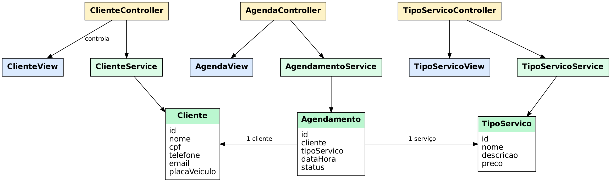
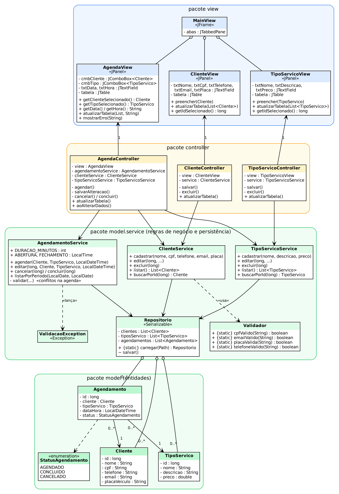
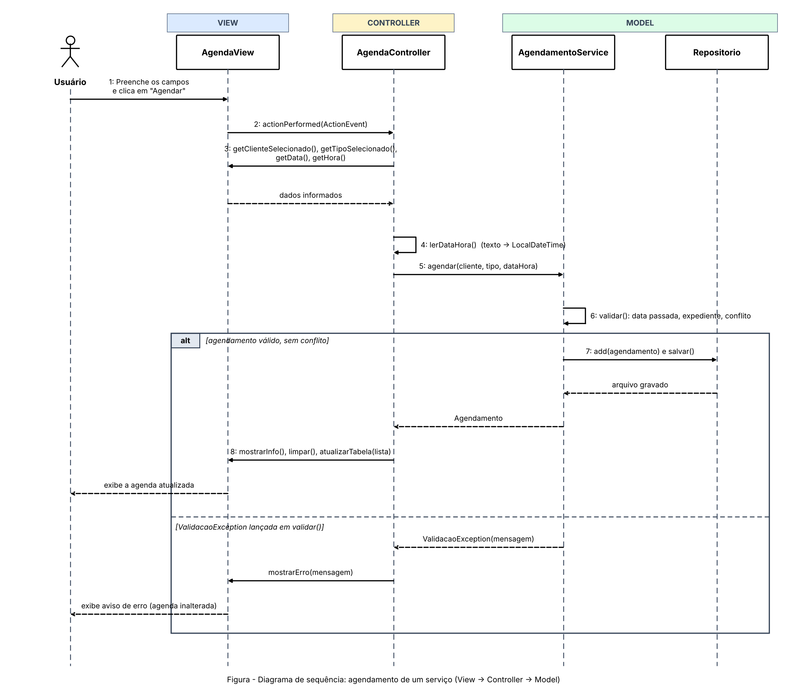

# Lava Rápido – Controle de Clientes e Agenda de Serviços

Aplicação desktop em **Java Swing**, com arquitetura **MVC**, para gerenciar clientes, tipos de serviço e a agenda de um lava rápido.

## Funcionalidades
- **Clientes:** cadastrar, editar, excluir e listar (nome, CPF, telefone, e-mail e placa do veículo), com validação dos dados.
- **Tipos de serviço:** cadastrar, editar, excluir e listar (nome, descrição e preço).
- **Agenda:** agendar, editar, cancelar e concluir serviços, com visualização diária ou semanal.
- **Validações da agenda:** não permite data passada, horário fora do expediente (08:00 às 18:00) nem conflito de horário (cada atendimento ocupa 60 minutos).
- **Persistência em arquivo:** os dados ficam em `dados/lavarapido.dat`.

## Como compilar e executar
Requisito: JDK 11 ou superior.
    mkdir -p out
    javac -encoding UTF-8 -d out $(find src -name "*.java")
    java -cp out app.Main

No NetBeans: Arquivo > Abrir Projeto > selecione a pasta do projeto > Executar Projeto (F6). Classe principal: `app.Main`.

## Estrutura do projeto
- `src/model` e `src/model/service`: entidades, regras de negócio e persistência
- `src/view`: telas Swing
- `src/controller`: controle de eventos
- `docs`: diagramas UML

## Diagramas UML

### Diagrama de classes (simplificado)

### Diagrama de classes (completo)

### Diagrama de sequência – agendamento de um serviço

## Documentação
A documentação completa (explicação dos diagramas, arquitetura MVC e instruções de execução) está em [Documentacao_LavaRapido.docx](Documentacao_LavaRapido.docx).
